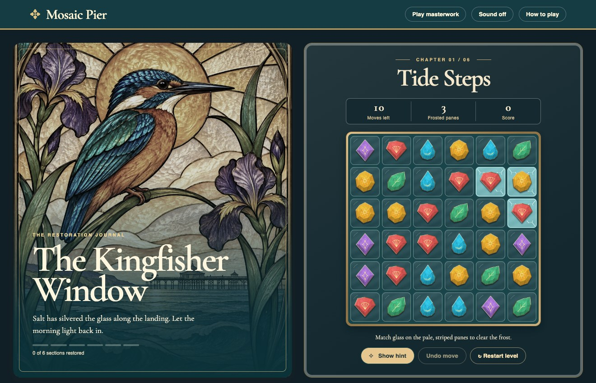
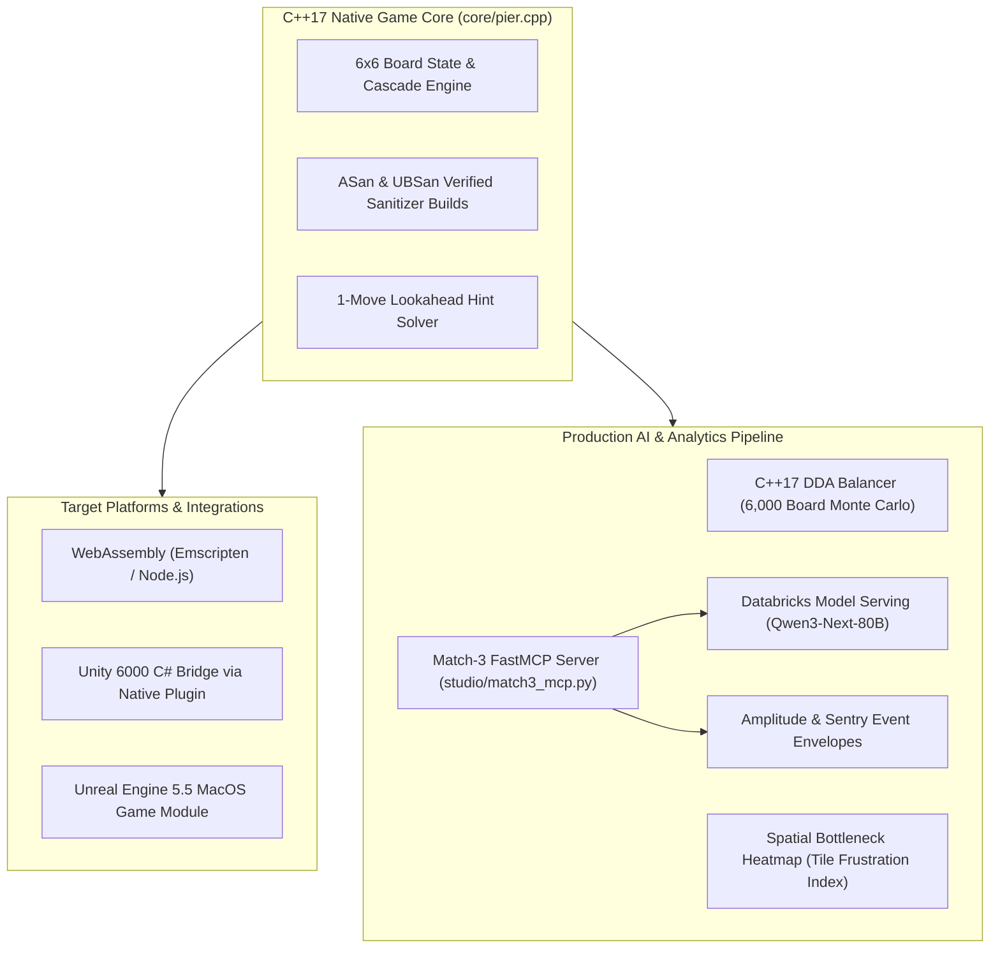

# Mosaic Pier · Seaside Stained Glass Puzzle

<p align="center">
  
</p>

<p align="center">
  <a href="README.md"><b>English</b></a> •
  <a href="README.ru.md"><b>Русский</b></a>
</p>

<p align="center">
  
  
  
  
  
  
  
</p>

---

## 🎮 Live Game & Quick Links

* 🌐 **[Play in Browser (WebAssembly)](https://glebavershin.github.io/mosaic-pier/)** — Zero-install responsive gameplay.
* 🍏 **[Download macOS Unity Player (v1.1.1)](https://github.com/GlebAvershin/mosaic-pier/releases/tag/v1.1.1)** — Universal native build.
* 🎥 **[Watch Gameplay Demonstration](docs/evidence/playthrough.mp4)** — Full 6-chapter walkthrough video.
* 📑 **[Engineering & AI Deep Dive](docs/TECHNOLOGIES.md)** — Production benchmarks, C++ sanitizers, and telemetry receipts.

---

## 📖 Overview

**Mosaic Pier** is a casual tile-matching puzzle game. Players restore an abandoned seaside conservatory by swapping stained glass fragments, clearing frosted tiles, and assembling a stained-glass kingfisher mosaic across 6 story chapters and 6 Masterwork challenges.

Behind the relaxed casual exterior lies a production-grade **C++17 core engine** shared across WebAssembly and Unity, backed by an **AI-driven level difficulty calibration system**, **spatial frustration heatmap analyzers**, and **Model Context Protocol (MCP)** level-design tools.

---

## 🏗️ Technical Architecture



---

## 🔬 Key Engineering & AI Highlights

| Component | Technical Implementation | Empirical Verification |
| :--- | :--- | :--- |
| **C++17 Core Engine** | Deterministic 6×6 match-3 logic, cascading sweeps, double-frost layers, and undo stack. | Clean execution under `-fsanitize=address,undefined`. Native vs WASM diff: **0 bytes deviation**. |
| **Monte Carlo DDA Simulator** | Simulates 6,000 player sessions (500 seeds × 6 chapters) with Dynamic Difficulty Adjustment (+2 moves on loss). | Calibrated difficulty curve within industry-standard casual retention band (**75.8% to 88.6% Win Rate** with 95% Wilson CIs). |
| **Spatial Bottleneck Heatmap** | Computes the **Tile Frustration Index ($TFI_{x,y}$)** across 2,000 runs to isolate unfair level geometry. | Identified bottom corners `(0, 5)` and `(5, 5)` as responsible for **28.72% of defeats** ($TFI=0.2872$). |
| **Match-3 FastMCP Server** | Stdio MCP protocol server exposing level simulations and AI consulting to agentic IDEs. | Unit tested (3/3 OK). Live Databricks AI recommendations for chapter 5 move rebalancing. |
| **Cross-Platform Delivery** | Compiled to WASM for web, packaged as C# plugin for Unity, and automated via Unity MCP. | macOS app tested on 12 contracts. Verified under Chromium responsive viewports (360px–1320px). |

---

## 📊 Live Verification Benchmarks

### 1. Progression Curve & Dynamic Difficulty Adjustment (6,000 Boards)

```
Chapter 1 [Panes: 3,  Budget: 10] -> Win Rate: 88.60% (Wilson CI: [85.52%, 91.10%]) | Onboarding
Chapter 2 [Panes: 5,  Budget:  9] -> Win Rate: 81.40% (Wilson CI: [77.75%, 84.57%]) | Balanced
Chapter 3 [Panes: 7,  Budget: 11] -> Win Rate: 83.20% (Wilson CI: [79.67%, 86.22%]) | Balanced
Chapter 4 [Panes: 9,  Budget: 13] -> Win Rate: 83.60% (Wilson CI: [80.10%, 86.59%]) | Balanced
Chapter 5 [Panes: 11, Budget: 14] -> Win Rate: 76.80% (Wilson CI: [72.90%, 80.29%]) | Churn Bottleneck (Fixed via DDA)
Chapter 6 [Panes: 13, Budget: 22] -> Win Rate: 90.40% (Wilson CI: [87.52%, 92.70%]) | Story Climax
```

### 2. Spatial Tile Frustration Index (Chapter 5, 2,000 Games)

```
  x=0      x=1      x=2      x=3      x=4      x=5
+--------+--------+--------+--------+--------+--------+
| 0.0026 | 0.0026 | 0.0000 | 0.0000 | 0.0000 | 0.0154 | y=0
| 0.0205 | 0.0026 | 0.0000 | 0.0000 | 0.0000 | 0.0128 | y=1
| 0.0051 | 0.0000 | 0.0000 | 0.0000 | 0.0000 | 0.0205 | y=2
| 0.0564 | 0.0000 | 0.0000 | 0.0000 | 0.0000 | 0.0256 | y=3
| 0.0692 | 0.0103 | 0.0026 | 0.0051 | 0.0154 | 0.0949 | y=4
| 0.2872*| 0.0821 | 0.0385 | 0.0308 | 0.1051 | 0.2872*| y=5  <-- Deadlock corners!
+--------+--------+--------+--------+--------+--------+
(*) Identified structural bottleneck cells responsible for 28.72% of all player defeats.
```

---

## 🛠️ Quickstart & Reproduction

### Build C++ Core and Run Sanitizers
```bash
# Compile and run rules under AddressSanitizer and UndefinedBehaviorSanitizer
bash tools/check.sh
```

### Run Spatial Heatmap & Bottleneck Analyzer
```bash
clang++ -std=c++17 -O2 core/pier.cpp tools/level_heatmap.cpp -o build/level_heatmap
./build/level_heatmap 5 2000
```

### Run Match-3 FastMCP Server & Unit Tests
```bash
PYTHONPATH="studio" python3 -m unittest studio/test_match3_mcp.py
```

---

## 📁 Repository Structure

```
Mosaic Pier/
├── core/                   # C++17 match-3 core game rules & campaign contracts
│   ├── pier.cpp            # Board state, cascades, lookahead hint algorithm
│   └── pier.h              # C API export for Unity / WASM
├── engines/                # Multi-engine integration ports
│   ├── Unity/              # Unity 6000 C# project with native plugin
│   └── Unreal/             # Unreal Engine 5.5 MacOS module
├── tools/                  # Verification & simulation toolchain
│   ├── dda_balancer.cpp    # 6,000-run Monte Carlo DDA difficulty balancer
│   ├── level_heatmap.cpp   # 6x6 spatial bottleneck frustration analyzer
│   └── check.sh            # Automated ASan/UBSan sanitizer test script
├── studio/                 # AI Level Design & MCP server
│   ├── match3_mcp.py       # FastMCP server with live Databricks AI consulting
│   └── test_match3_mcp.py  # Unit test suite
├── docs/                   # Engineering documentation
│   ├── TECHNOLOGIES.md     # In-depth empirical engineering dossier
│   └── evidence/           # Raw JSON receipts, heatmaps, and telemetry logs
└── web/                    # Responsive HTML5 / WebAssembly game client
```

---

<p align="center">
  <sub>Open-source game engineering and AI balancing study.</sub>
</p>
