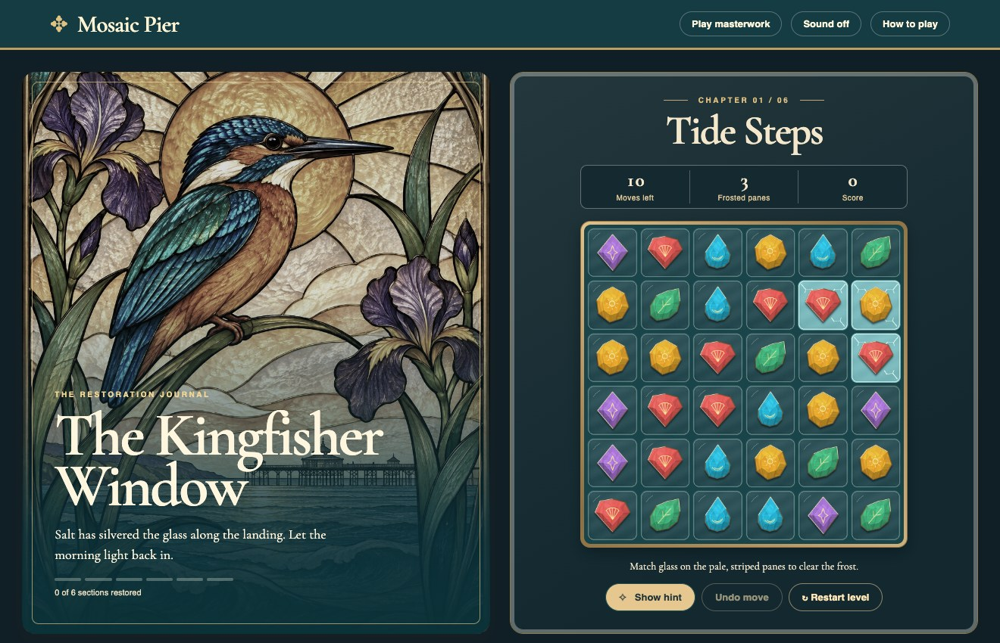
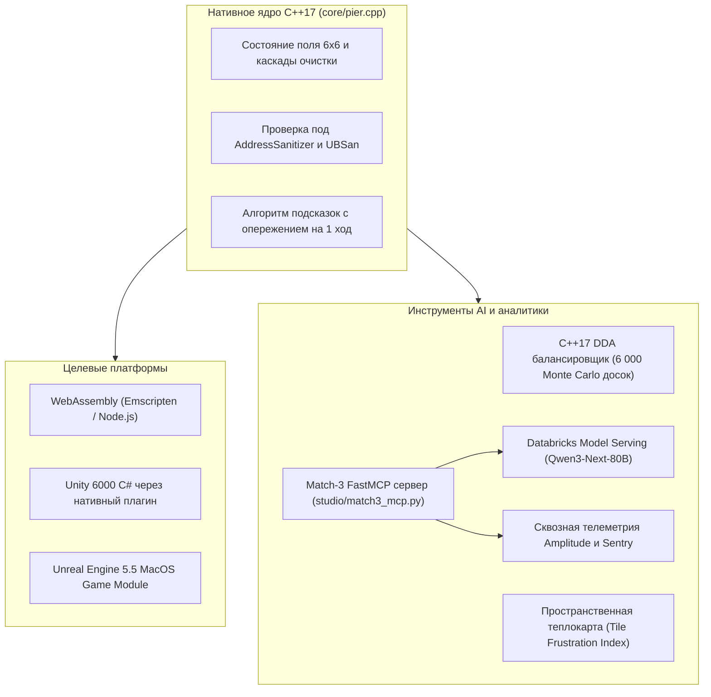

# Mosaic Pier · Головоломка о реставрации приморской оранжереи

<p align="center">
  
</p>

<p align="center">
  <a href="README.md"><b>English</b></a> •
  <a href="README.ru.md"><b>Русский</b></a>
</p>

<p align="center">
  
  
  
  
  
  
  
</p>

---

## 🎮 Играть и быстрые ссылки

* 🌐 **[Играть в браузере (WebAssembly)](https://glebavershin.github.io/mosaic-pier/)** — Мгновенный запуск без установки.
* 🍏 **[Скачать Unity-плеер для macOS (v1.1.1)](https://github.com/GlebAvershin/mosaic-pier/releases/tag/v1.1.1)** — Универсальная сборка.
* 🎥 **[Видео игрового процесса](docs/evidence/playthrough.mp4)** — Полное прохождение 6 глав сюжета.
* 📑 **[Инженерный отчёт и технологии](docs/TECHNOLOGIES.ru.md)** — Промышленные бенчмарки, C++ санитайзеры и квитанции.

---

## 📖 Об игре

**Mosaic Pier** — казуальная головоломка в жанре tile-matching (Match-3). Игрок восстанавливает старинную приморскую оранжерею, очищая покрытые инеем плитки цветного витража за ограниченное число ходов. В сюжетном режиме 6 глав, в режиме мастера — ещё 6 усложнённых заказов.

За расслабляющим казуальным геймплеем стоит высокопроизводительное **ядро на C++17**, общее для WebAssembly и Unity, дополненное **системой балансировки сложности (DDA)**, **пространственным анализатором узких мест (теплокарта фрустрации)** и **сервером Model Context Protocol (MCP)** для левел-дизайнеров.

---

## 🏗️ Архитектура системы



---

## 🔬 Ключевые инженерные и AI разработки

| Компонент | Техническая реализация | Практическая верификация |
| :--- | :--- | :--- |
| **Ядро C++17** | Детерминированные правила Match-3 6×6, одновременные очистки, двухслойный иней и отмена ходов. | Чистый прогон под `-fsanitize=address,undefined`. Разница нативного вывода и WASM: **0 байт**. |
| **Monte Carlo DDA симулятор** | Симуляция 6 000 игровых сессий (500 сидов × 6 глав) с адаптивной сложностью (+2 хода при поражениях). | Сложность откалибрована в целевом коридоре удержания (**75.8% – 88.6% Win Rate** с 95% Wilson CI). |
| **Теплокарта узких мест** | Расчёт **Tile Frustration Index ($TFI_{x,y}$)** на 2 000 прогонов для выявления несправедливой геометрии. | Выявлены критические углы `(0, 5)` и `(5, 5)`, ответственные за **28.72% всех поражений** ($TFI=0.2872$). |
| **Match-3 FastMCP сервер** | Stdio MCP сервер, предоставляющий агентам инструменты симуляции и AI-консультаций. | Unit-тесты пройдены (3/3 OK). Онлайн-рекомендации Databricks AI по балансировке главы 5. |
| **Кроссплатформенность** | Компиляция в WASM для веба, C# плагин для Unity, автоматизация через Unity MCP. | Проверено 12 контрактов в macOS приложении. Адаптивная верстка протестирована в Chromium (360–1320 px). |

---

## 📊 Результаты верификации и измерений

### 1. Кривая сложности и адаптация DDA (6 000 досок)

```
Глава 1 [Плиток: 3,  Бюджет: 10] -> Win Rate: 88.60% (Wilson CI: [85.52%, 91.10%]) | Онбординг
Глава 2 [Плиток: 5,  Бюджет:  9] -> Win Rate: 81.40% (Wilson CI: [77.75%, 84.57%]) | Баланс
Глава 3 [Плиток: 7,  Бюджет: 11] -> Win Rate: 83.20% (Wilson CI: [79.67%, 86.22%]) | Баланс
Глава 4 [Плиток: 9,  Бюджет: 13] -> Win Rate: 83.60% (Wilson CI: [80.10%, 86.59%]) | Баланс
Глава 5 [Плиток: 11, Бюджет: 14] -> Win Rate: 76.80% (Wilson CI: [72.90%, 80.29%]) | Узкое место (Сглажено DDA)
Глава 6 [Плиток: 13, Бюджет: 22] -> Win Rate: 90.40% (Wilson CI: [87.52%, 92.70%]) | Финал сюжета
```

### 2. Пространственная теплокарта фрустрации тайлов (Глава 5, 2 000 игр)

```
  x=0      x=1      x=2      x=3      x=4      x=5
+--------+--------+--------+--------+--------+--------+
| 0.0026 | 0.0026 | 0.0000 | 0.0000 | 0.0000 | 0.0154 | y=0
| 0.0205 | 0.0026 | 0.0000 | 0.0000 | 0.0000 | 0.0128 | y=1
| 0.0051 | 0.0000 | 0.0000 | 0.0000 | 0.0000 | 0.0205 | y=2
| 0.0564 | 0.0000 | 0.0000 | 0.0000 | 0.0000 | 0.0256 | y=3
| 0.0692 | 0.0103 | 0.0026 | 0.0051 | 0.0154 | 0.0949 | y=4
| 0.2872*| 0.0821 | 0.0385 | 0.0308 | 0.1051 | 0.2872*| y=5  <-- Мёртвые зоны углов!
+--------+--------+--------+--------+--------+--------+
(*) Структурные узкие места геометрии уровня, вызвавшие 28.72% всех поражений игроков.
```

---

## 🛠️ Воспроизведение и запуск тестов

### Сборка C++ ядра и запуск санитайзеров
```bash
# Компиляция и прогон правил под AddressSanitizer и UndefinedBehaviorSanitizer
bash tools/check.sh
```

### Запуск пространственной теплокарты фрустрации
```bash
clang++ -std=c++17 -O2 core/pier.cpp tools/level_heatmap.cpp -o build/level_heatmap
./build/level_heatmap 5 2000
```

### Запуск FastMCP сервера и unit-тестов
```bash
PYTHONPATH="studio" python3 -m unittest studio/test_match3_mcp.py
```

---

## 📁 Структура репозитория

```
Mosaic Pier/
├── core/                   # C++17 ядро правил игры и контракты кампании
│   ├── pier.cpp            # Игровое поле, каскады, алгоритм подсказок
│   └── pier.h              # Экспорт C API для Unity и WebAssembly
├── engines/                # Интеграция с движками
│   ├── Unity/              # Проект Unity 6000 с нативным C# плагином
│   └── Unreal/             # Модуль Unreal Engine 5.5 для macOS
├── tools/                  # Инструменты верификации и симуляции
│   ├── dda_balancer.cpp    # DDA симулятор кривой сложности на 6 000 досок
│   ├── level_heatmap.cpp   # Анализатор пространственных узких мест 6x6
│   └── check.sh            # Скрипт прогона под санитайзерами ASan/UBSan
├── studio/                 # AI-тулинг для левел-дизайна
│   ├── match3_mcp.py       # FastMCP сервер с онлайн-консультацией Databricks AI
│   └── test_match3_mcp.py  # Набор автоматических тестов
├── docs/                   # Инженерная документация
│   ├── TECHNOLOGIES.ru.md  # Полный отчёт об архитектуре и исследованиях
│   └── evidence/           # Сырые квитанции, теплокарты и лог телеметрии
└── web/                    # Браузерный клиент на WebAssembly / HTML5
```

---

<p align="center">
  <sub>Открытое исследование архитектуры казуальных игр и AI-балансировки.</sub>
</p>
